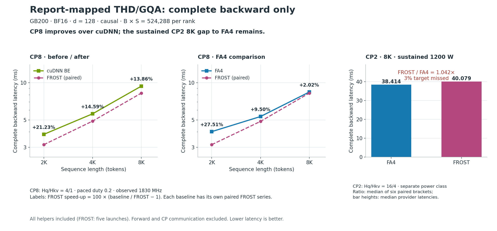
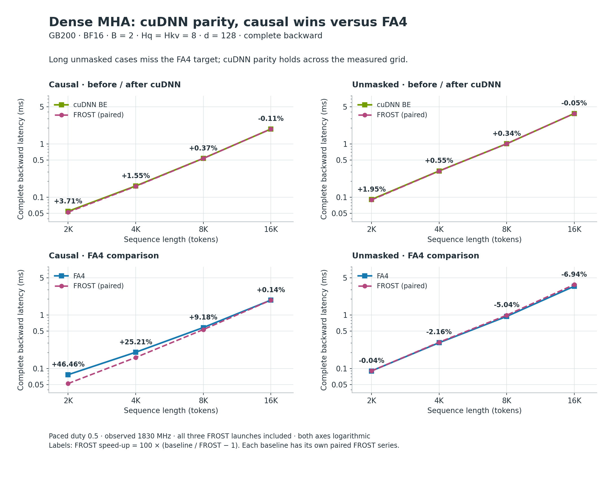
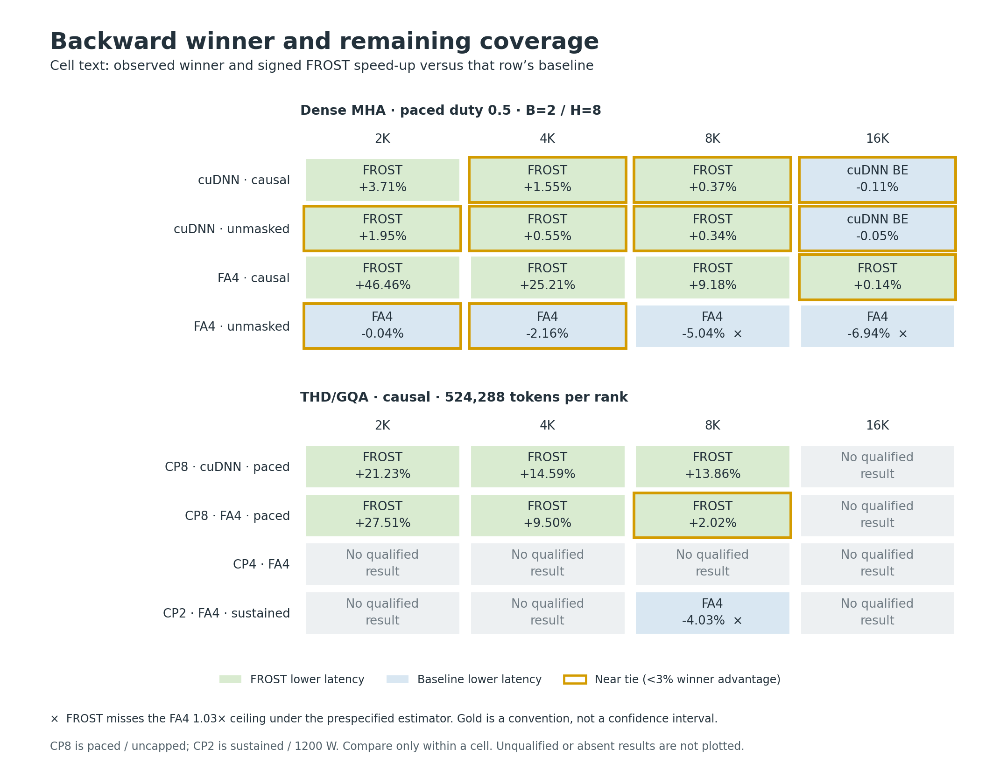

# B200/GB200 d128 attention backward: before and after FROST

FROST matches cuDNN backward on the measured dense grid and improves the
report-mapped CP8 THD/GQA cases by **+13.86% to +21.23%**. Relative to FA4,
the CP8 cases improve by **+2.02% to +27.51%**. The sustained CP2 8K case
remains **4.20% slower than FA4**; dense unmasked 8K and 16K also miss the
3% target.

These figures use the log-log sweep and near-tie-map conventions of the
[original TransformerEngine report](https://github.com/sudhakarsingh27/TransformerEngine/blob/5d4673da00226be3772cdb135db4cdd0e7b8edeb/benchmarks/attention/README.md).
Here, **before** means the measured cuDNN backend and **after** means the
new FROST implementation in a matched comparison. These are complete
**backward-only** timings, including initialization, gradient conversion,
and grouped reduction. Forward and context-parallel communication are
excluded. They are not a subtraction from, or a remeasurement of, the
original report's forward + backward + communication endpoint.

## Report-mapped THD/GQA workloads



[Vector figure](thd_backward_latency.svg)

The CP8 panels retain the separately paired FROST measurements for each
baseline. Their green and blue curves are not a direct cuDNN-versus-FA4
comparison. Both CP8 axes are logarithmic. The CP2 panel uses a separate
linear axis and a sustained, power-limited protocol; it is not a CP scaling
comparison.

The original workload uses BF16 THD, global Hq/Hkv=32/8, d=128, causal
attention, and B×S=524288. The A2A mapping used here retains those tokens
per rank and reduces the local heads: Hq/Hkv=4/1 for CP8 and 16/4 for CP2.
The plotted CP8 shapes are B256/S2048, B128/S4096, and B64/S8192; CP2 is
B64/S8192. No communication is executed in these measurements. FROST's
complete THD/GQA backward includes five kernel launches.

## Dense baseline



[Vector figure](dense_backward_latency.svg)

The dense shapes use B=2, Hq=Hkv=8, d=128 and BF16, so they are smaller than
the fixed-token THD/GQA workload. FROST preserves the backend's five-product
pipeline and uses three launches: initialization, main backward, and FP32
dQ conversion. Every launch is included. The nearly coincident cuDNN and
FROST curves establish the port's baseline parity. Small signed differences
remain visible in the labels; near ties are marked below.

## Winners, near ties, and missing coverage



[Vector figure](backward_winner_map.svg)

Cells show the observed winner and **FROST's** signed speed-up,
`100 × (baseline / FROST − 1)`. Positive is faster. Gold outlines mark a
winner's latency advantage below 3%, using `slower / faster − 1`; this is
a display convention, not a confidence interval or a change to the timing
gates. A cross marks a missed FA4 target (`FROST / FA4 > 1.03`) under the
prespecified estimator. These two annotations answer different questions:
which provider was faster, and whether FROST met its parity target.

CP4 and THD 16K have no qualified parity result in this report. Missing
cells are not zero, interpolated, or inferred from another CP size.

## Measurement method and limits

The measurements were collected on 2026-10-15 and 2026-10-16 UTC on an
exclusive NVIDIA GB200, SM100, 152 SMs, aarch64. The backend is cuDNN
9.27.0.21; FROST uses CuTeDSL 4.8.0. FA4 is 4.0.0b35 at commit
`1fc0221183e799363001394a12dd9e78e15f5dda`, with nondeterministic backward
and its default SM100 two-CTA route verified. The historical library
versions in the original report have not been established, so these
results do not attribute a difference to a version change.

| Measurement class | Timing protocol | Clock and power evidence |
|---|---|---|
| Dense, paced duty 0.5 | Independent A/A control and three A/B/A rounds; at least 100 samples and 250 ms of event time per slot | Requested and qualified observed busy clocks: 1830 MHz; no required cap/thermal counter increases |
| CP8, paced duty 0.2 | Independent A/A control and three A/B/A rounds; at least 100 iterations per slot | Requested and qualified observed busy clocks: 1830 MHz; no cap-counter increases |
| CP2 8K, sustained 1200 W | 20 A/A and alternating A/B/A / B/A/B slots; 64 warmups and 200 timed replays per slot | FA4 busy median: 1567 MHz / 1166.528 W; FROST: 1447 MHz / 1186.021 W; software power capping in every qualified busy read, without thermal/brake counter increases |

All rows are CUDA-event complete-graph timings, after separate correctness
validation. They include the helper kernels of both providers. The CP2
captures include five FROST kernels and seven FA4 kernels. Latencies are
not normalized by clock. MMA SOL is unavailable without calibrated
effective-clock evidence; no roofline percentage is inferred here.

For dense and CP8, each baseline latency is the median of the three round
values `(A1 + A2) / 2`; FROST latency is the median of the corresponding B
slots. Their displayed speed-up is the ratio of those summaries. Dense
target checks use the conservative observed envelope
`max(FROST round medians) / min(all baseline slot medians)`. CP8 meets the
target in every measured round. The conservative dense unmasked FA4 ratios
are 1.053925 at 8K and 1.075213 at 16K.

For sustained CP2, the prespecified result is the median of six **paired**
FA4/FROST ratios: 0.9597085851, or **−4.0291% FROST speed-up**. Its
reciprocal is FROST/FA4=1.0419829680, or **4.1983% higher latency**. Bar
heights are separate medians of provider latencies, so dividing those
displayed medians is a different estimator. All six observed ratios miss
1.03 (range 1.039542–1.049599). Unchanged 2% timing gates pass; the maximum
half-window drift and empirical noise floor is 1.925880%. That observed
floor is not a confidence interval. The 3% target miss is an observed
result, not a statistical confidence bound.

Dense FA4 uses its own normal saved forward O/LSE, with forward excluded
from timing. Both THD providers receive the same saved O/LSE. Read those
measurement families separately. No result here establishes full training
step latency, distributed scaling, deterministic backward performance,
FP16 grouped performance, or performance on another GPU/SM-count class.

## Optimization checkpoint

The charts show the retained public baseline. Later isolated reduction and
mask-skip candidates did not establish an eligible whole-backward gain.
Four-head scheduling was rejected before GPU timing because it introduced
an inner-loop local-memory spill, including after one algebraic repair.
Raw next-tile LSE/Delta prefetch passed all 17 numerical cases and its
single timing comparison, but its **+0.1121%** whole-backward result was
below **1.5062%** observed timing noise. None was promoted. That prefetch
comparison was against FROST, not FA4, and does not revise the CP2 gap.

The scheduling and prefetch experiments are complete, but optimization is
not exhausted. The next useful step is profiling the exact sustained CP2
workload to identify dependencies and register lifetimes worth changing.
Other unmeasured candidates are partitioning FP32 dQ accumulation across
two workspaces to reduce atomic contention, and combining the final dQ
cast with the dK/dV fold in one launch. These ideas have no demonstrated
gain; extra workspace traffic or scheduling costs could erase their
benefit. CP4 and THD 16K performance qualification also remains.

## Data and figure reproduction

[All 23 summarized measurements](measurements.md) are available as
[JSON](measurements.json). The dataset preserves workload, pairing,
measurement class, estimator, and target verdict. It contains sanitized
summary values rather than raw timing samples. The figure generator
validates the expected grid and summary arithmetic, then renders PNG and
SVG. It does not run or reproduce the GPU experiment.

From the repository root, with Python 3.10+ and Matplotlib installed:

```bash
python benchmark/attention_training/reports/b200_d128_backward/plot.py
```

Figures were rendered with Matplotlib 3.10.9 and DejaVu Sans. Use
`--output-dir <directory>` to render elsewhere. No GPU or cuDNN import is
required. Plot style follows the cited report's logarithmic sweep panels
and gold near-tie outlines; all chart code and figures here are newly
authored from the recorded backward measurements.
