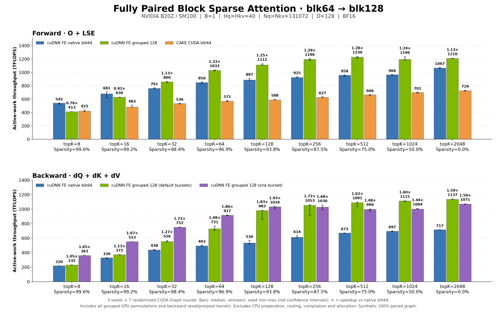

# Exact grouped BSA: fully paired benchmark

This benchmark measures the standalone grouped implementation in this PR
against native cuDNN FE blk64, with optional CAKE CUDA forward from
[FlashInfer PR #4593](https://github.com/flashinfer-ai/flashinfer/pull/4593).
There is no dependency on Omni Attention. The attention kernels are the
existing cuDNN FE blk128 implementations; this change adds exact grouping,
GPU permutations and reuse of sparse metadata.

## Reproduce

Install this checkout with the usual CUDA/cuDNN build dependencies and Torch,
CuTe DSL >= 4.7.0, cuda-python and tvm-ffi. Run serially on an idle SM100 GPU:

```bash
python benchmark/bsa_grouped/bench.py \
  --length 131072 --heads 40 \
  --topk 8 16 32 64 128 256 512 1024 2048 \
  --seeds 4593 17 2026 --rounds 7 \
  --output benchmark/bsa_grouped/results/b20z_131k.json

# Optional: include the original CUDA implementation, not a CuTe DSL port.
# Add --cake-checkout /path/to/flashinfer-pr4593 to the command above.
# The recorded run used FlashInfer commit c326d2c5c7cc2b96d58129371dc070a9b5af2205.

# Plotting needs matplotlib and numpy, independently of GPU execution.
python benchmark/bsa_grouped/plot.py \
  benchmark/bsa_grouped/results/b20z_131k.json \
  --output-dir benchmark/bsa_grouped/results
```

A small harness/accuracy smoke test uses `--length 1024 --heads 3 --topk 2 8 16`.

## What is measured

- B=1, Hq=Hkv=40, Nq=Nkv=131072, D=128, BF16, noncausal attention on NVIDIA
  B20Z / SM100 (148 SMs). Software versions and source SHA256s are in the raw JSON.
- The synthetic route graph is **100% pairable on both axes**. Generate random
  topK/2 neighbors on a half-size graph, include the diagonal, mirror KV IDs,
  and mirror Q rows. Every KV participates; most pairs are nonadjacent. This
  is a favorable grouping case, not a claim about arbitrary sparse masks.
- Forward produces O and natural-log LSE. Backward uses the same saved O/LSE
  for both implementations to isolate backward numerical differences.
- Grouped timing includes every required pack/unpack kernel. Backward also
  includes all accumulator clears, delta/LSE preprocessing, and conversion.
- Both sides reuse prebuilt CSR. For the native64 baseline only, the serial
  benchmark records the warmed compiled call and reuses its buffers/CSR,
  resetting its accumulation workspace on every call. It restores the native
  compile cache immediately after recording. Production grouped APIs do not
  intercept caches.
- CPU routing, preparation, compilation, allocation and Python dispatch are
  excluded from GPU time. CPU preparation is measured separately, including
  device transfers and a completion synchronization. The default and one-bucket
  preparations are timed independently; no hidden cache reuses the CPU analysis.
- Three seeds, seven rounds per seed, randomized implementation order, one
  call per CUDA Graph replay, two eager warmups and one graph warmup. Aggregate
  bars use the median of per-seed medians. Error bars show seed min/max, **not
  confidence intervals**. The JSON retains every timing sample.
- Default GPU clock/power policy; clocks are not locked. Prior workload and
  operating state can affect the result. Small differences should not be
  treated as established wins.
- TFLOPS counts **active sparse work**, not dense-equivalent work:
  FWD = `4 * B * H * N * topK * 64 * D / seconds / 1e12`;
  BWD uses factor 10. topK and sparsity always refer to the original blk64 graph.

## Results



The [table](results/table.md) includes throughput and milliseconds.
[CSV](results/summary.csv), [raw samples](results/b20z_131k.json), [source provenance](results/PROVENANCE.md),
[SVG](results/performance.svg) and [PDF](results/performance.pdf) are included.
The figure contains only cuDNN FE variants and CAKE; CAKE has no backward
series in this experiment.

With all GPU permutations included, grouped forward is 1.13–1.29× native64
for topK >= 32, and 0.76×/0.92× at topK=8/16. Default grouped backward ranges
from 1.05× to 1.83×; one-bucket backward ranges from 1.44× to 1.93× and is
best at short lists. The error bars expose seed/workload-state variation;
in particular, do not interpret the 1.05× point as a robust small win.
Median CPU preparation ranges from 272 ms to 17.3 seconds across topK,
far above a single GPU call.

`grouped_default` uses the native blk128 bucket policy (three buckets here).
`grouped_one_bucket` uses `bucket_size_blocks=Nq//128=1024`. One bucket means
one owner for each dK/dV KV128 tile. It does not mean dQ group=2, and dQ still
reduces contributions from multiple KV tiles. One-bucket backward is shown
separately because it is not the best policy for every topK.

The GPU comparison requires reusable routing metadata. CPU preparation can
outweigh these GPU savings if a layer rebuilds routing every training step;
the table reports that overhead explicitly. No end-to-end training speedup
is claimed.

## Correctness and API coverage

Every measured case checks O/LSE and dQ/dK/dV against native64; CAKE O/LSE is
checked when enabled. Independent FP64 autograd checks and changed-input
CUDA Graph replay live in the grouped test suite, alongside exact sparse-graph
and CSR reconstruction, invalid-input rejection, nonadjacent batch/head-specific
pairs, variable counts, inactive capacity, unused NaN KV blocks and side streams.

```bash
cd test/python
pytest -q -s -m L0 \
  block_sparse_attention/cutedsl/test_BSA_grouped.py \
  block_sparse_attention/cutedsl/test_BSA_attention_forward.py \
  block_sparse_attention/cutedsl/test_BSA_attention_backward.py \
  core/frost/test_frost_kernel_name_prefix.py
```

The SM100 validation run passed 52 tests, skipped 33 architecture/configuration
cases, and deselected 76 outside L0. See the [API documentation](../../docs/fe-oss-apis/bsa_grouped.md)
for the supported contract and preparation lifecycle.
