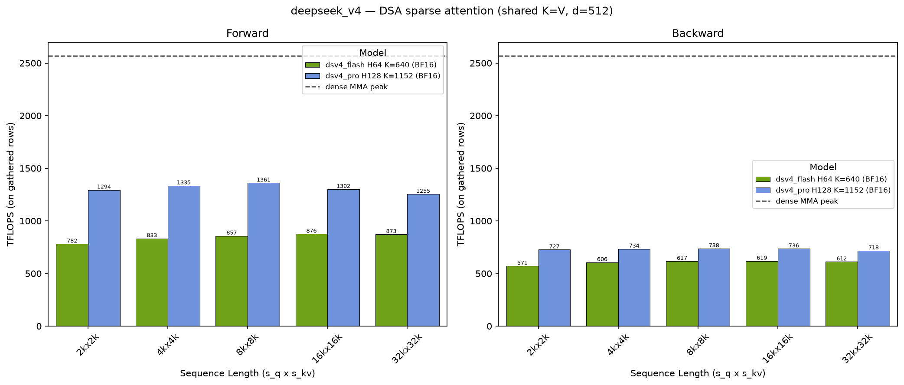

# DSA Sparse Attention Benchmarks

Benchmarks for the cuDNN Frontend DeepSeek Sparse Attention (DSA) kernels:
the sparse core attention (`cudnn.DSA.SparseAttentionForward` /
`SparseAttentionBackward`) and the lightning indexer
(`cudnn.DSA.indexer_forward_top_k_wrapper`, `SparseIndexerScoreRecompute` +
`IndexerTopK`, `IndexerBackward`). Two ways to run them:

- **Configuration-based suite** (`runner.py` + `configs/`) — sweeps model
  presets over sequence lengths, phases, components, KV storage formats and
  flat/paged pools, writes a CSV and two charts per run. Arranged like
  [`../attention_training`](../attention_training/README.md) and
  [`../attention_inference`](../attention_inference/README.md).
- **Single scripts** (`benchmark_dsa_sparse_attention_forward.py`,
  `benchmark_dsa_sparse_attention_backward.py`,
  `benchmark_dsa_indexer_h32.py`, `benchmark_dsa_indexer_top_k.py`) — ad-hoc
  shapes, execute-vs-wrapper split, compact-H32 adapter comparisons, and
  `profile` mode for nsys/ncu.

## Contents

- `configs/` - Benchmark configuration files
  - `deepseek_v4.py` - DeepSeek-V4 Flash (H64, K=640) and Pro (H128, K=1152), 2k..32k; core only (legacy axes)
  - `deepseek_v41.py` - DeepSeek-V4.1 Flash core (H64, K=640) + 32-head indexer in dense and hierarchical modes; all axes
  - `glm53.py` - GLM-5.3 (H64, d=576/512, K=2048) and GLM-5.3-Flash (H64, NoPE d=512, K=2048, 4-token pools) + 32-head indexers; all axes
  - `qwen38_qsa.py` - Qwen3.8 QSA (GQA 24/2, d=256, separate K/V, 4-token blocks); every cell is a coverage row today; opt-in
- `runner.py` - Configuration-based benchmark runner (one subprocess per servable case; skipped rows cost none)
- `benchmark_single_dsa.py` - Single-case worker the runner calls; prints a `RESULT,` line
- `support.py` - The one place every skip rule lives (`decide_support`), kernel variant table, byte footprints
- `kv_pool.py` - Flat / paged KV pools, per-query top-k id lists, causal visible counts (torch, no cudnn)
- `config_types.py` - `ModelPreset`, `DsaBenchmarkConfig`, `BenchmarkResult`
- `charts.py` - Chart generation (`<config>.webp` legacy figure, `<config>_extended.webp`)
- `tests/` - CPU-only unit tests for enumeration, skip rules, generators, parsing and charts
- `run_all.sh` - Runs configs and lands results in `results/<config>/<arch>/`
- `results/` - Benchmark outputs (CSV and charts)

## Configuration-Based Suite

```bash
# from the repository root
python -m benchmark.dsa.runner --list-configs
python -m benchmark.dsa.runner --config deepseek_v4
python -m benchmark.dsa.runner --config deepseek_v4 --dry-run
python -m benchmark.dsa.runner --config deepseek_v4 --filter flash --pass fwd
python -m benchmark.dsa.runner --config deepseek_v41 --component indexer --phase generation
python -m benchmark.dsa.runner --config glm53 --kv-dtype mxfp8 --flat
python -m benchmark.dsa.runner --config deepseek_v4 --output-dir benchmark/dsa/results/deepseek_v4/b200

# all default configs for one architecture label (optionally pinning a GPU)
benchmark/dsa/run_all.sh b200 GPU-<uuid>
# qwen38_qsa is opt-in (not in the default list)
benchmark/dsa/run_all.sh b200 GPU-<uuid> qwen38_qsa
```

Filters: `--filter <model substring>`, `--backend`, `--dtype` (the Q /
activation dtype), `--pass {fwd,bwd}`, `--component {core,indexer}`,
`--phase {context,generation,bprop}`, `--kv-dtype <format>`, `--paged` /
`--flat`.

Requires a compute capability 10.x GPU for the forward passes and the
indexer, compute capability 9.x or 10.x for the core backward, PyTorch with
CUDA, `pip install nvidia-cudnn-frontend[cutedsl]` (or a development install
of this repository's `python/` package), and `pandas`/`matplotlib`/`seaborn`
for CSV and charts. `pynvml` is optional; with it each row records the
dense-MMA peak at the sampled SM clock (`peak_mma_tflops`) and the legacy
chart draws it as a dashed line. Pin one GPU with `CUDA_VISIBLE_DEVICES`: the
shared CuTe DSL compiler and the indexer APIs read the *current* device.

### Axes

A case is one point of

```
model x (s_q, s_kv) x backend x data_type x phase        (context, bprop)
model x kv_len x batch x q_tokens x backend x data_type  (generation)
    x component x kv_dtype x paged x indexer_mode x deterministic_bwd
```

| Axis | Values | Meaning |
|---|---|---|
| `component` | `core`, `indexer` | sparse core attention over the gathered rows, or the lightning indexer (scoring + top-k) |
| `phase` | `context`, `generation`, `bprop` | prefill (one request, `s_q == s_kv`), decode / MTP rows over a long cache (batched), training backward. `profile_pass` stays `fwd` for context and generation, `bwd` for bprop |
| `kv_dtype` | `bfloat16`, `mxfp8`, `nvfp4` | **storage format** of the KV record (core) or the index-key pool (indexer); the compute precision follows the kernel. Formats no kernel consumes are enumerated as skipped coverage rows |
| `paged` | `False`, `True` | flat `(rows, D)` pool, or a paged pool addressed through a per-request block table (`page_size` 64, pages assigned in random order so gathers scatter) |
| `indexer_mode` | `dense`, `hierarchical` | indexer rows only: score every causally visible key, or score only the 16384 candidate positions the DSv4.1 source layer published |
| `deterministic_bwd` | per config | bprop rows only |

`q_seqlen` / `kv_seqlen` are **per request** in every phase: a generation row
has `q_seqlen = q_tokens`, `kv_seqlen = kv_len` and `batch_size` requests;
the worker derives the flat row count (`batch_size * q_tokens`) and the pool
(`batch_size * kv_len` rows). Legacy configs (`components`, `kv_dtypes`,
`paged`, `phases` left at their defaults) expand to exactly the same cases,
labels and order as before; `deepseek_v4` is still 20 cases.

Every architecture / dtype / shape / API-existence rule lives in
`support.decide_support`, evaluated **in the runner** before anything is
spawned: a skipped row costs no subprocess and carries the suite's own
wording in `error_message`. A runner without torch or CUDA (compute
capability unknown) treats every architecture-gated row as unservable and
skips it with the same wording rather than spawning a worker to find out.
The worker re-evaluates the same function and
keeps the `UNSUPPORTED,<reason>` + exit-3 path only for declines the kernels
raise themselves (`check_support`, or the one untimed probe call where the
CuTe JIT happens). A compile or launch failure after that is an honest
`success=False` row with the traceback tail, never a skip.

### What each (component, phase) measures — and does not

Inputs are random tensors in the kernels' layouts; the id lists come from
`kv_pool.make_topk_ids`, unique ids inside the row's own request, not sorted
by position (the real indexer emits sorted ids; the order changes the access
pattern, not the kernel's work). Context and bprop rows gather the **full**
top-k (every row `topk` unique random rows of the pool, the per-token upper
bound, as the committed `results/` CSVs were measured); generation rows are
causal to their position `kv_len - q_tokens + j` and padded with `-1` plus a
matching `topk_length` when fewer than `topk` tokens are visible, which no
shipped `kv_len` reaches. The worker declines (skipped row) a configuration
that would hand the kernels a short row without `use_topk_length`, or a row
with `topk_length < indexer_topk` (the forward kernel's indexer prefix
contract). Timing is CUDA events around each steady-state call after a 256
MiB L2 flush, median of `num_iterations` after warmup; the first untimed
probe call compiles. Each case runs in its own subprocess.

| component / phase | Timed call | Does not measure |
|---|---|---|
| core / context | `SparseAttentionForward.execute` with preallocated `out`, `max_logits`, `lse` (+ `lse_indexer` when `indexer_topk > 0`); flat ids or ids mapped through the block table (`backend_detail` carries `page=64`) | — |
| core / generation | the same prefill kernel on `batch_size * q_tokens` flat rows gathering inside their own request's `kv_len`-token pool: `detail` says `flat-row prefill kernel; rows=..; no split-KV`. There is no decode / split-KV core kernel: one CTA per query row, so small `B x q_tokens` rows are latency numbers, not a decode SOL | a decode-shaped kernel; the Q-projection / RoPE / output-side work |
| core / bprop | `SparseAttentionBackward.execute` with preallocated `dq`/`dkv` and a reusable workspace; `out`/`lse` come from a chunked PyTorch reference; gradient zeroing the kernel performs is included. Paged ids are allowed (the backward reads the same flat ids) | a forward launch |
| indexer / context (dense) | `indexer_forward_top_k_wrapper` (fused scoring + top-k over the causal prefix) with caller-owned candidate buffer and outputs, `return_softmax=False`, so the timed call allocates nothing and does no host sync. `mxfp8` quantizes **both** Q and K to e4m3 with e8m0 block-32 scales packed once in setup (the kernel has no bf16-Q x mxfp8-K form) | the indexer's own RoPE and the MXFP4 quantization of Q / K (the `rope_qdq_inplace` contract in production); weights projection |
| indexer / generation (dense) | the same wrapper in BSHD form, `q (B, q_tokens, H_idx, 128)`, `k (B, kv_len // ratio, 1, 128)`, `q_causal_offsets = kv_len - q_tokens`; `detail` carries `bytes_gathered = B * (kv_len // ratio) * key_bytes` so `gather_gbps` is the key-scan bandwidth | same as above |
| indexer / hierarchical (context + generation, bf16 only) | the DSv4.1 **consumer** step: `SparseIndexerScoreRecompute` over 16384 synthesized causal-valid candidates per row (newest block pinned), then `IndexerTopK(top_k=512)` over the `(rows, 16384)` scores. `time_ms` = both steps; `time_step1_ms` / `time_step2_ms` hold them separately | the source layer's extra block-max / block-top-k emission (not a cuDNN kernel; the source's scoring cost *is* the dense row) |
| indexer / bprop | `IndexerBackward` (default backend) with random fp32 scores and global int32 indices; the kernel overwrites `attn_score` in place, so a pristine copy is restored before every timed iteration, outside the window | — |

TFLOPS count only the gathered / scored work:

```
core fwd FLOPs      = 2 * H * gathered * (d_qk + d_v)            gathered = sum(topk_length) (rows * topk without topk_length)
core bwd FLOPs      = 2 * H * gathered * (3 * d_qk + 2 * d_v)
indexer dense FLOPs = 2 * H_idx * 128 * sum_rows(n_vis)       n_vis(pos) = (pos + 1) // ratio, clamped to kv_len // ratio
indexer hier. FLOPs = 2 * H_idx * 128 * sum_rows(min(pos + 1, 16384))   (valid candidates; top-k adds no FLOPs)
indexer bprop FLOPs = 6 * S * H_idx * 128 * indexer_topk_select      (three GEMMs: dQ, dK, dW, as benchmark_dsa_indexer_h32.py counts them)
```

`n_vis` follows the FE kernels' completed-group rule (floor); the DSv4.1
reference model also admits the open group (ceil), at most one key per row
apart. With `index_granularity = 4` (GLM-5.3-Flash, QSA) a row selects
complete 4-token blocks and the list expands to token ids, so the gather
has the model's 4-row pool locality. The dense-MMA peak (`peak_mma_tflops`)
uses the KV format for indexer rows (`mxfp8` = 2x the bf16 rate on compute
capability 10.x) and `data_type` for core rows; there is no NVFP4 entry.

### Skip matrix (what runs today)

Cells the suite enumerates but no kernel serves are written as
`skipped=True` rows (`success=False`, `time_ms = inf`) with the reason, so
the CSV and the extended chart show the coverage gap. For `deepseek_v41`
(324 cases) and `glm53` (384 cases):

| component / phase | kv_dtype | paged | cc 9.0 | cc 10.0 | cc 10.7 |
|---|---|---|---|---|---|
| core / context, generation | bfloat16 | flat, paged | skip (forward needs 10.x) | run | run |
| core / any | mxfp8 | any | skip | skip (no MXFP8-KV core kernel) | skip |
| core / bprop | bfloat16 | flat, paged | run | run | run (shared compiler) |
| indexer / context, generation (dense) | bfloat16, mxfp8 | flat | skip (needs 10.x) | run | run (shared compiler) |
| indexer / context, generation (hierarchical) | bfloat16 | flat | skip | run | run (shared compiler) |
| indexer / hierarchical | mxfp8 | flat | skip | skip (candidate-restricted scoring is bf16-only) | skip |
| indexer / any | any | paged | skip | skip (dense BSHD/THD keys only) | skip |
| indexer / bprop | bfloat16 | flat | skip for 32 heads (9.x needs 64) | run | run (shared compiler) |
| any / bprop | mxfp8, nvfp4 | any | skip | skip (no low-precision backward) | skip |
| any / any | nvfp4 | any | skip | skip (no NVFP4 / MXFP4 consumer) | skip |

"Shared compiler" rows on compute capability 10.7 additionally require an
installed CuTe DSL whose `Arch` table has the target for that part (public
wheel 4.8.0 or newer); without it the runner
skips them with `installed CuTe DSL lacks the target for compute capability
10.7` (the core forward compiles its own `sm_100f` image and is unaffected).
Servable cells: `deepseek_v41` 80 of 324 on cc 10.0 / 10.7 (26 with a DSL
lacking the target), 10 on cc 9.0; `glm53` 118 of 384 (44), 20 on cc 9.0;
`qwen38_qsa` 0 everywhere (see below).

### Bytes per token

`bytes_per_token` is a static column on every row (skipped ones included):
the KV record a core row gathers, or the amortized index key an indexer row
scans. `gather_gbps = bytes_gathered / time_ms` is filled only on success
rows whose detail reports `bytes_gathered` (core and indexer generation).

| record | bfloat16 | mxfp8 (e4m3 + e8m0 / 32) | nvfp4 (e2m1 + e4m3 / 16) |
|---|---:|---:|---:|
| core, shared K=V, d=512 (dsv4x, glm53_flash) | 1024 | 528 | 288 |
| core, shared K=V, d=576 (glm53) | 1152 | 594 | 324 |
| core, separate K and V, 2 heads x d=256 (qsa) | 2048 | 1056 | 576 |
| index key, 128-dim, one per token | 256 | 132 | 68 (MXFP4: e2m1 + e8m0 / 32) |
| index key, one per 4-token pool (glm53_flash, qsa) | 64 | 33 | 17 |

Core generation `bytes_gathered = rows * topk * record + rows * topk * 4
(ids) + rows * H * (d_qk + d_v) * 2 (Q read, O write)`, i.e. `gather_gbps`
is the row's whole DRAM traffic, not the KV records alone; indexer generation
`bytes_gathered = B * (kv_len // ratio) * key_bytes`.

### Generation grid

`generation_kv_lens` x `generation_batch_sizes` x `q_tokens in sorted({1,
mtp_rows})` per model; the shipped configs use `kv_len in {8192, 131072}`,
`B in {8, 128}` and `mtp_rows = 2` for dsv41_flash and glm53 (one MTP draft
row), 1 otherwise. Query row `j` of a request sits at position `kv_len -
q_tokens + j` and sees `pos + 1` tokens, so `q_tokens = 1` scans the whole
cache. The bf16 pool at `B = 128 x 128k` is 16 GiB (d=512) / 18 GiB (d=576);
the paged variant adds four spare pages.

### Model presets

`deepseek_v4` (`configs/deepseek_v4.py`): V4's sparse core is flat MQA over a
shared K=V record of `d=512`. The lightning indexer selects 512 (Flash) /
1024 (Pro) entries per query and the softmax runs over their union with the
last 128 tokens and a per-head sink; folding the window into the index list
gives logical `K = 640` / `1152` with `indexer_topk = 512` / `1024` (the
indexer-selected prefix whose LSE the forward kernel also emits). Heads: 64
(Flash) / 128 (Pro). Sequence lengths 2k, 4k, 8k, 16k, 32k with `s_q == s_kv`;
every query gathers the full top-k, i.e. the per-token upper bound. Core
only, legacy axes (this config is the pinned legacy enumeration).

`deepseek_v41` (`configs/deepseek_v41.py`): V4.1-Flash keeps the V4 sparse
core (H=64, shared d=512 record, 512 indexer-selected entries + 128-token
window, sink); its 2x-compressed / uncompressed pools and cross-layer KV and
index sharing change what the indexer selects from, not the per-query
gather, so the core preset is V4-Flash's (`K = 640`, `indexer_topk = 512`).
Indexer: 32 heads x 128, one key per token, top-k 512, `dense` and
`hierarchical` modes; `mtp_rows = 2`. Only a Flash checkpoint is published.

`glm53` (`configs/glm53.py`): GLM-5.3 (GLM-5.2's architecture) runs
V3.2-style DSA on the MLA latent: the absorbed query attends a 576-wide
shared record (512 KV latent + 64 RoPE) and reads the 512 latent channels
back as V; token top-2048, no window fold, no sink, so `indexer_topk = 0`;
32-head indexer over one key per token, `mtp_rows = 2`. `glm53_flash`'s
sparse layers are NoPE MLA, so the record is 512 wide; its indexer scores one
key per four-token pool (`indexer_pool_ratio = 4`) and selects 512 pools =
2048 raw tokens (`index_granularity = 4`; the incomplete tail pool, <= 3
tokens, is omitted). `glm53` gathers independent random rows; `glm53_flash`
gathers 512 random complete 4-token blocks, so its pool locality is modeled.

`qwen38_qsa` (`configs/qwen38_qsa.py`, **opt-in**): Qwen3.8-Flash-Next QSA
is GQA (24 query / 2 KV heads) with separate K and V of `d=256`, 2048 tokens
selected as 512 four-token blocks, no sink, and a 4-head indexer over one key
per 4-token block. Every cell is a skipped coverage row today: the core
kernels serve the shared K=V latent only and the indexer kernels require 32
or 64 query heads per KV head. It is not in `run_all.sh`'s default list; run
`--config qwen38_qsa` by name.

To add a model, copy `configs/deepseek_v4.py`, edit the `ModelPreset`s
(`num_q_heads`, `head_dim_qk` in `{512, 576}`, `topk`, `indexer_topk`,
`has_sink`, and the appended indexer / GQA fields) and the
`DsaBenchmarkConfig` (`seqlens`, `profile_pass` or `phases`, `components`,
`kv_dtypes`, `paged`, generation grid, iteration counts), and run `--config
<name>`. Core forward variants are `(H, d_qk)` in `{(64, 512), (64, 576),
(128, 512)}` with `indexer_topk` in `{0, 512, 1024}` (`2048` for H64 too);
keep `topk` a multiple of 64 so no hidden index padding sits in the timed
region. Backward accepts any head count with `d_qk` in `{512, 576}` and a
deterministic mode on compute capability 10.x for H16/H32/H64/H96/H128.

### Output

```
results/<config>/<gpu>/
    <config>_<timestamp>.csv    # one row per case (see BenchmarkResult)
    <config>.webp               # fwd | bwd TFLOPS vs seqlen for core bf16 flat rows (unchanged legacy figure)
    <config>_extended.webp      # one panel per (component, phase) with cases beyond that set; hatched = skipped cell
```

The CSV keeps the legacy 25 columns first (`config_name` .. `backend_detail`)
and appends `component, phase, kv_dtype, paged, batch_size, indexer_mode,
bytes_per_token, gather_gbps, time_step1_ms, time_step2_ms`. The extended
chart plots TFLOPS for core context / bprop and milliseconds otherwise, hue
= `kv_dtype [paged] [hierarchical]`; a config whose rows are all skipped
still gets the coverage grid.

### Tests

```bash
# CPU-only contracts: legacy enumeration pin (deepseek_v4 = 20 cases), case counts,
# decide_support matrix on cc (9,0) / (10,0) / (10,3) / (10,7), byte and FLOP constants,
# make_topk_ids validity, RESULT / UNSUPPORTED parsing, CSV column order, charts
python -m unittest discover -s benchmark/dsa/tests -v

# the same contracts under pytest L0 plus a GPU smoke of six tiny cells (skips without cudnn[cutedsl] / a 10.x GPU)
cd test/python && pytest deepseek_sparse_attention/cutedsl/test_DSA_benchmark_suite.py
```

### Results

#### GB200 - DeepSeek-V4


- `dsv4_flash: H=64, d=512, K=640 (indexer_topk=512)`; `dsv4_pro: H=128, d=512, K=1152 (indexer_topk=1024)`; bf16, sink + `topk_length`, non-deterministic backward.

### Follow-ups

- QSA core rows via the compute capability 10.7 sparse GQA d256 kernel
  (BSHD operands, 4-token block ids, paged pools with one block table, a
  decode form with `S_q <= 4`): a third core setup, not the flat-row path.
- NVFP4 KV / MXFP4 index keys once a consumer kernel exists (the rows and
  byte footprints are already enumerated).
- A decode-shaped (split-KV) core kernel; until then generation core rows are
  the prefill kernel on flat rows.
- The hierarchical source step (block-max emission + block top-k) if it
  becomes a cuDNN kernel.

## Single Scripts

### Standalone Indexer Top-K

`benchmark_dsa_indexer_top_k.py` compares `tie_break=0` and `2` with 8K local
queries, KV=8K/32K/128K/512K, K=1024/2048, FP32 scores, `next_n=1`, and
`return_val=False`. Causal lengths follow one rank of a single-sequence zigzag
CP partition: for Q local queries, H=Q/2 and rank r, concatenate lengths
`[r*H+1, (r+1)*H]` and `[KV-(r+1)*H+1, KV-r*H]`. CP=KV/Q; CP1 naturally
covers every query. Rank 0 is the default. All local rows are measured without
extrapolation. The largest default score matrix occupies 16 GiB, plus outputs
and scratch. Internal scratch row chunks and all their launches are included.

```bash
python -m benchmark.dsa.benchmark_dsa_indexer_top_k --csv topk-random.csv
python -m benchmark.dsa.benchmark_dsa_indexer_top_k --distribution duplicates --csv topk-duplicates.csv
# An interior rank; CP=128K/8K=16:
python -m benchmark.dsa.benchmark_dsa_indexer_top_k --tokens 131072 --cp-rank 7
```

Timing follows the existing [DSA per-call event median](benchmark_single_dsa.py)
and [CSA graph replay](../csa/bench_csa_compressor.py) patterns: 20 side-stream
warmup calls before capture, one complete API call per graph, and 50 timed
replays. Both policies share score/length addresses and alternate measurement
order. A 256 MiB buffer flushes L2 before each start event, so flush time is
excluded. Events are primed and reused, following
[causal-convolution timing](../causal_conv1d_update_sm100.py). Both graphs are
warmed again after CPU validation. CSV reports every
sample (milliseconds to six decimal places) and the median; `--warmup` and
`--samples` control the counts.

Compilation, capture, score generation and sampled CPU references are outside
timing. `speedup_0_over_2 = time(0) / time(2)`; values below one mean tie policy 2
is slower. These are selector GPU timings, excluding CPU enqueue overhead and
score computation. They do not measure CP communication, sparse attention or
complete DSA forward/training latency. The fixed local matrix does not reproduce
Megatron's separate front/back calls, smaller score-budget chunks or per-call KV
cropping.

The reference samples the first/middle/last local rows and the K boundary when
present in the shard, checking
causal bounds, uniqueness and the selected set without requiring output order.
Use `--distribution equal`, `sparse-left` or `sparse-right` for additional tie
patterns; the sparse cases put k−1 strict winners and two cutoff ties near one
end of each causal prefix. `--num-queries` must be even and divide every KV
length, and `--cp-rank` must be valid for every selected case. `--tokens`,
`--top-k`, `--samples` and `--warmup` can narrow or repeat the workload.
SM90+ is required; memory admission is an
estimate and does not guarantee allocation success.

### Compact-H32 Indexer Backward

`benchmark_dsa_indexer_h32.py` measures the default SM100 indexer-backward
wrapper with compact H32 tensors against caller-side
`torch.nn.functional.pad` to H64. Outputs are preallocated, H64 output slicing
is excluded, case order is rotated, and L2 is flushed before each CUDA-event
sample. The script validates the H64 result against the compact path before
timing. Profile mode also exposes already-padded H64 inputs as a kernel-only
sanity control.

```bash
python -m benchmark.dsa.benchmark_dsa_indexer_h32
python -m benchmark.dsa.benchmark_dsa_indexer_h32 profile --profile-case compact_h32
```

Add `--deterministic` to benchmark the fixed-owner dK path with its reported
caller-owned workspace. Add `--topk-indices-global` for the flat KV-id contract
used by packed DSA forward. For example, a 1M-context/r4 indexer at CP64 has
16K local query rows and 256K compressed KV rows:

```bash
python -m benchmark.dsa.benchmark_dsa_indexer_h32 \
  --seqlen-q 16384 --seqlen-k 262144 --topk 512 \
  --topk-indices-global --deterministic
```

### Sparse Attention Forward

`benchmark_dsa_sparse_attention_forward.py` benchmarks the public SM100
`cudnn.DSA.sparse_attention_forward_wrapper` API for H64/D512 or D576 and the
H128/D512 small-top-k Prefill kernel. The default shape is the H64 production
anchor `S_q=4096, S_kv=5120, K=640, indexer_topk=512`.

Two cuDNN Frontend timings are reported:

- **DSA execute path (preallocated)** — the concrete CuTe kernel is
  compiled before timing, all enabled output buffers are reused, and each
  iteration calls the same `SparseAttentionForward.execute()` object.
- **DSA public wrapper** — each iteration calls
  `sparse_attention_forward_wrapper`, including any GPU work caused by output
  allocation and logical-K padding/layout normalization.

Both timings use CUDA events on the current stream after independent warmup.
The execute measurement is not raw kernel-only time: it still includes the
lightweight public execution adapter, and for a non-multiple-of-64 logical K
it also includes internal index padding. CUDA events measure GPU elapsed time;
Python/host-side wrapper and allocation overhead is not separately captured.
The script prints both logical and padded K so that distinction is visible.

Run the default H64/D512 case or select another frozen specialization:

```bash
python benchmark_dsa_sparse_attention_forward.py
python benchmark_dsa_sparse_attention_forward.py --heads 64 --head-dim 576 --topk 640 --indexer-topk 512
python benchmark_dsa_sparse_attention_forward.py --heads 128 --head-dim 512 --topk 1152 --indexer-topk 1024
```

Common options are `--seqlen-q`, `--seqlen-kv`, `--heads`, `--head-dim`,
`--topk`, `--indexer-topk`, `--warmup`, `--repeat`, `--seed`,
`--no-attn-sink`, and `--use-topk-length`. Forward
requires an SM100-family GPU, BF16 inputs, PyTorch with CUDA support, and the
cuDNN Frontend `[cutedsl]` dependencies.

### Sparse Attention Backward

Microbenchmark for the DeepSeek Sparse Attention (DSA) backward kernel in the
cuDNN Frontend CuTe DSL package, driven through the public
`cudnn.DSA.sparse_attention_backward_wrapper` API. The wrapper dispatches to
the Hopper (SM90) or Blackwell (SM100) implementation based on the active
CUDA device.

#### What is measured

Inputs are flat MQA tensors: `q (S_q, H, d_qk)`, a shared
`kv (S_kv, d_qk)` buffer (K = V), and per-query global top-k indices
`topk_idxs (S_q, topk)` with unique random indices per query row. The forward
`out`/`lse` consumed by the backward kernel come from a chunked PyTorch
reference so that this benchmark isolates backward and does not include a
forward launch.

Each timed iteration is one full wrapper call — gradient-buffer zeroing,
workspace allocation, and the preprocess/backward/convert kernels — i.e. the
cost a training step pays per backward invocation. Timing uses a single
CUDA-event window around `--repeat` iterations and reports the average.

Reported TFLOPS use the 5-matmul model of the backward pass (recompute S, dV,
dP, dQ, dK):

```
FLOPs = 2 * S_q * H * topk * (3 * d_qk + 2 * d_v)
```

#### Requirements

- Hopper (SM90) or Blackwell (SM100) GPU
- PyTorch with CUDA support
- `pip install nvidia-cudnn-frontend` (or a development install of
  this repository's `python/` package) -- the CuTe DSL dependencies are
  required dependencies and come with either installation method

#### How to run

Default sweep (`seqlens 4096,8192 x topks 128,512,1024,2048`, bf16,
`d_qk = d_v = 512`, 64 heads):

```bash
python benchmark_dsa_sparse_attention_backward.py
```

Custom shapes and CSV output:

```bash
python benchmark_dsa_sparse_attention_backward.py --seqlens 4096,8192,16384 --topks 512,2048 --csv results.csv
python benchmark_dsa_sparse_attention_backward.py --head-dim 576   # 512 value dims + 64 RoPE dims
python benchmark_dsa_sparse_attention_backward.py --nheads 16 --head-dim 576  # SM100 H16/D576 M128 backend
python benchmark_dsa_sparse_attention_backward.py --nheads 128  # SM100/SM103 BF16 H128/D512 two-CTA backend
python benchmark_dsa_sparse_attention_backward.py --nheads 128 --head-dim 576 --csv d576_2cta.csv  # SM100/SM103 BF16 H128/D576 two-CTA backend
```

The H128/D576 two-CTA route uses the same public-wrapper measurement, including
workspace allocation and initialization. Add `--no-topk-length` to cover the
variant without a lengths tensor; the default passes a full-length tensor.
The existing benchmark arguments and CSV format apply to both variants.

Options:

- `--seqlens` — comma-separated total query lengths; `seqlen_kv = seqlen_q`
  for every config. Configs with `topk > seqlen_kv` are skipped.
- `--topks` — comma-separated top-k values.
- `--nheads` — number of query heads (default 64).
- `--head-dim` — QK head dim, `512` or `576`; `head_dim_v` is derived (512).
- `--dtype` — `bfloat16` (default) or `float16`.
- `--no-attn-sink` — disable the attention sink (passes `-inf` sink logits).
- `--no-topk-length` — omit the `topk_length` tensor. Kernels with and
  without `topk_length` are different compiled variants; the default
  benchmarks the `topk_length` variant with every row at the full top-k
  count.
- `--warmup` / `--repeat` — iterations per config (defaults 10 / 50; the
  first warmup iteration also triggers kernel compilation).
- `--csv` — write results to a CSV file.

#### Results

##### B200

Generated on an NVIDIA B200 with the default
sweep settings (`nheads=64`, `d_qk = d_v = 512`, bf16, attention sink and
`topk_length` enabled, `warmup=10`, `repeat=50`), using `torch 2.12.1`,
`nvidia-cutlass-dsl 4.5.2`, and `nvidia-cudnn-frontend` built from this
repository. That DSL release predates the package's current `>=4.6.2` floor;
the numbers are a historical measurement and have not been re-run on a
supported DSL.

| seqlen_q | seqlen_kv | topk | BWD ms | BWD TFLOPS |
|---------:|----------:|-----:|-------:|-----------:|
|     4096 |      4096 |  128 |  0.563 |     305.09 |
|     4096 |      4096 |  512 |  1.243 |     552.87 |
|     4096 |      4096 | 1024 |  2.198 |     625.35 |
|     4096 |      4096 | 2048 |  4.168 |     659.46 |
|     8192 |      8192 |  128 |  1.094 |     313.97 |
|     8192 |      8192 |  512 |  2.489 |     552.16 |
|     8192 |      8192 | 1024 |  4.538 |     605.76 |
|     8192 |      8192 | 2048 |  8.562 |     642.06 |

#### Profiling

`profile` mode runs a single warmed-up backward call (using the first value
of `--seqlens` and the last value of `--topks`) wrapped in
`cudaProfilerStart/Stop` and an NVTX range, so nsys/ncu capture only the
kernels of interest:

```bash
nsys profile -t cuda,nvtx --capture-range=cudaProfilerApi --capture-range-end=stop -o dsa_bwd \
  python benchmark_dsa_sparse_attention_backward.py profile --seqlens 8192 --topks 2048

ncu --profile-from-start off -o dsa_bwd \
  python benchmark_dsa_sparse_attention_backward.py profile --seqlens 8192 --topks 2048
```

The suite worker has the same mode: `python benchmark/dsa/benchmark_single_dsa.py
... --profile` runs one warmed call of the case inside
`torch.cuda.profiler.start/stop` and an NVTX range and prints a `RESULT` line
with that single timing.
