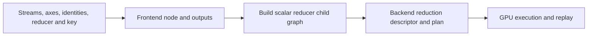

# How custom reductions work

A custom reduction lets an application describe the combining step as a small graph. Its state contains one or more tensor streams. Each stream is one component of the reduction state. For example, argmax carries both a candidate value and its index, allowing the comparison to update them together. The operation fits into the ordinary graph, so its streams can come from graph inputs or preceding operations, and its outputs can feed later operations.

## What the caller provides

The caller supplies input tensors, reduction dimensions, one typed identity per stream, a reducer callback and a semantic key. Optional compute types control the scalar arithmetic for each stream. All streams share a shape; the operation returns an output for each stream in the same order, preserving rank with extent one on reduced dimensions.

`Custom_reduction_identity` owns the scalar value and its exact type and storage representation. Its type must match the corresponding output stream. This keeps identities such as floating-point negative infinity and an integer index sentinel distinct. For order-independent results, the caller supplies an associative, commutative combination and matching two-sided identities.

## Graph construction and execution

Calling `custom_reduction` records a frontend node and creates output tensors. During expansion, the frontend creates a candidate child graph containing symbolic scalar `lhs` and `rhs` tensors for each stream. It invokes `reducer(child_graph, lhs, rhs)` to build the pointwise combination and return one resulting scalar tensor per stream. These tensors describe the state transition; the callback runs on the host during graph construction.

Validation checks the stream metadata, identities, output shapes, reducer operands and scalar body boundaries. The frontend retains the child graph after its expansion and body validation succeed. A callback exception or refused candidate body leaves that candidate uncommitted, allowing a later expansion to try again. Rebuilding an already materialized node reuses its child graph.



The backend bridge builds the child operation graph and attaches it to a cuDNN reduction operation. It supplies input/output descriptors, reduction dimensions, typed identity values, and the child graph's `lhs`, `rhs` and result UIDs. Compute types are forwarded when explicitly supplied. The resulting parent graph follows the normal plan-selection and execution path. Execution binds tensor buffers and workspace to that plan; repeated execution runs the emitted reduction without re-entering the reducer callback.

## Keys, captured state and Python ownership

The semantic key identifies reducer behavior in the graph key. It must be deterministic and change whenever callback logic or captured configuration changes the generated body. Captured configuration becomes part of graph construction; changing execution input buffers supplies new data to the existing plan.

Python records custom reductions in its graph IR, then lowers ordered streams, identities, attributes and outputs into the C++ graph. Its callback adapter also resolves captured parent tensor operands and returned tensors through the lowering map. The native wrapper retains callback state, gives the child proxy shared ownership, and exposes callback references to Python's cyclic garbage collector. This supports captured parent state and retained child proxies without losing callbacks or hiding reference cycles. Child graph construction belongs inside the callback; a retained proxy should not be used to edit the materialized reducer afterward.

Graph JSON records inspection structure and the semantic key. Execution-plan serialization preserves the built backend plan; rebuilding a reducer from graph JSON would require the original callable, which is not serialized.

## Argmax as a state transition

Supply a value tensor and an equally shaped tensor of index values. The argmax helper builds comparisons and selects that carry the winning `(value, index)` pair together, including its tie and NaN policy. Its default identities are typed negative infinity and the largest index value. The caller chooses which result to expose:

```python
value, index = graph.custom_reduction(
    [values, indices], reduction_dims=[1],
    **cudnn.reduction_modifiers.argmax(cudnn.data_type.FLOAT),
)
index.set_output(True)
```

See the Custom Reduction API reference ([docs](/operations/CustomReduction), [GitHub](https://github.com/NVIDIA/cudnn-frontend/blob/develop/docs/operations/CustomReduction.md)) for signatures and examples.
