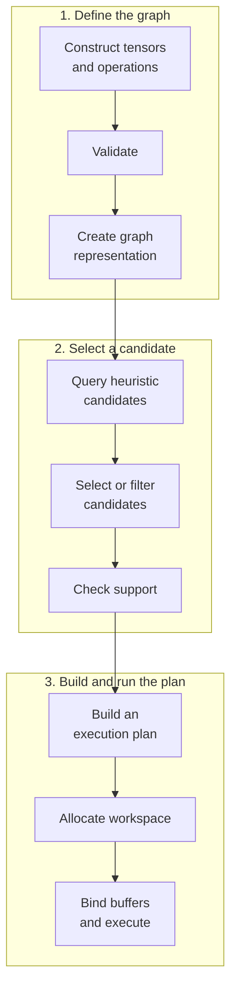

# Build and Extend a cuDNN Graph

The [Quick Start](/getting-started/quickstart) shows how to construct and
run one matrix multiplication. This tutorial starts from that working model,
extends it to a multi-operation graph, and explains what happens between graph
construction and repeated execution.

You will build a graph that computes:

`Y = ReLU(A @ B + bias)`

## Before you begin

To complete this tutorial, you need a CUDA-capable GPU and the
[installed prerequisites](/getting-started/installation) for your chosen
language. Run the [Quick Start](/getting-started/quickstart) first so that
you know the Python package or C++ headers can build and execute a graph.

## Follow the Graph Lifecycle

A cuDNN graph moves through these stages:



Graph construction records tensor metadata and dataflow; it does not perform
the tensor computation. Validation, creating the graph representation,
heuristic queries, support checks, and plan building prepare a graph-specific
implementation. Execution binds application buffers and enqueues that
implementation on a CUDA stream.

## Construct a Multi-operation Graph

The complete examples below create three operation nodes: matrix
multiplication, bias addition, and ReLU. The output descriptor returned by one
operation becomes an input to the next operation, forming the graph edges.

<Tabs>
<Tab title="Python" language="python">


<Code
  src="../samples/python/fusion.py"
  language="python"
  maxLines={0}
/>

Run the sample from the repository root:

```bash
python docs/samples/python/fusion.py
```

Pass the PyTorch tensors `a_data`, `b_data`, and `bias_data` directly to
the operations. The wrapper derives graph tensor descriptors from their
shapes, strides, and data types. Their values are not consumed during
graph construction.

`product` and `shifted` are virtual graph tensors. They carry metadata and
connect operations, but the application does not bind storage for them.
Only `result` is marked as an output. The `inputs` and `outputs` arguments
define the wrapper's positional execution interface.

The `cudnn.Graph` context manager hides graph building inside the wrapper.
When the `with` block exits, the wrapper performs the graph-building
lifecycle stages through workspace allocation. The following sections
explain those internal details; you do not need to understand or call them
to use this Python interface.

</Tab>
<Tab title="C++" language="cpp">


<Code
  src="../samples/cpp/fusion.cc"
  language="cpp"
  maxLines={0}
/>

Compile and run the sample from the repository root:

```bash
nvcc -std=c++17 -Iinclude docs/samples/cpp/fusion.cc -lcudnn -lnvrtc -o /tmp/cudnn_fe_fusion
/tmp/cudnn_fe_fusion
```

`Tensor_attributes` describes how cuDNN interprets each runtime pointer;
`graph.tensor(...)` does not allocate or copy data. The result of each
operation is virtual by default. Calling `set_output(true)` on `result`
makes the final tensor non-virtual so that it can be bound in the variant
pack.

</Tab>
</Tabs>
## Validate and Create the Graph Representation

For the explicit Python interface, `graph` throughout these lifecycle sections
refers to a `cudnn.pygraph` instance. `graph.validate()` checks graph structure
and tensor metadata and infers properties that were not specified explicitly.
It catches errors such as incompatible dimensions before plan creation.

`graph.build_operation_graph()` then creates the cuDNN backend graph
representation from the frontend definition. After this stage, cuDNN can query
engines for the exact operations, tensor layouts, data types, and attributes
in the graph.

The two language interfaces expose these stages differently:

- Exiting the higher-level Python `cudnn.Graph` context runs
  `graph.validate()` and `graph.build_operation_graph()` on its internal
  `cudnn.pygraph`, followed by the remaining plan stages.
- The C++ sample calls each lifecycle method explicitly. For applications that
  do not need stage-by-stage control, `graph.build(handle, heur_modes)` is the
  shortcut for validation through plan building.

After planning begins, treat the graph definition as fixed. Construct a new
graph when you need to change its operations or static tensor metadata.

## Select Heuristic Candidates

An engine is an implementation family, an engine configuration selects its
knobs, and an execution plan is a built configuration specialized for one
graph. Heuristics return ranked candidate configurations; they do not yet
produce a built plan or guarantee support.

cuDNN Frontend exposes three cuDNN backend heuristic modes:

- `A` returns ranked candidates quickly and handles most graph patterns.
- `B` can produce more accurate rankings than `A` at the cost of higher CPU
  latency during the query. It may fall back to `A` when appropriate.
- `FALLBACK` provides functional fallback candidates without an expectation of
  optimal performance.

Both examples query `A` followed by `FALLBACK`. Use `B` in place of `A` when
more accurate candidate ranking is worth the additional query latency.

The Python wrapper receives these modes through the `heuristics` argument. An
explicit Python `cudnn.pygraph` passes them to
`graph.create_execution_plans()`, while the C++ sample calls the corresponding
method directly. More advanced applications can filter candidates by numerical
behavior, determinism, or workspace limits before building a plan. See
[Engines, heuristics, plans, routing, and autotuning](/concepts/execution-plans)
for those selection controls.

## Check Support and Build an Execution Plan

`graph.check_support()` tests whether the candidate configurations support the
exact graph on the current cuDNN version and GPU. A graph can be structurally
valid but unsupported by every candidate.

`graph.build_plans()` compiles a supported candidate into an execution plan.
The default `HEURISTICS_CHOICE` policy builds the preferred viable candidate.
Use an all-candidates policy only when you need plan inspection or autotuning
and are prepared to manage the additional build cost.

The Python context manager performs both calls automatically when the `with`
block exits. The C++ sample makes them visible:

1. `graph.create_execution_plans(...)` obtains candidates.
2. `graph.check_support()` verifies that a candidate can implement the graph.
3. `graph.build_plans(HEURISTICS_CHOICE)` builds the selected plan.

Plan building is normally paid once for a compatible graph, not once per
execution.

## Allocate Workspace and Execute

After the plan is built, `graph.get_workspace_size()` reports the temporary
device storage required by that plan.

In Python, the `cudnn.Graph` wrapper allocates and retains workspace when the
context exits. Calling `graph(a_data, b_data, bias_data)` binds the declared
inputs, allocates the declared output, and enqueues execution on PyTorch's
current CUDA stream.

In C++, the application allocates workspace and output storage. The variant
pack maps every non-virtual graph tensor to a device pointer, and
`graph.execute(...)` enqueues the selected plan on the stream associated with
the cuDNN handle. Virtual intermediates do not appear in the variant pack.

Both examples compare the cuDNN result with an independently computed expected
result.

## Reuse the Built Graph

Keep the graph, execution plan, and workspace alive to amortize construction
and planning. Each execution may bind different buffers when their device,
shape, stride, data type, and alignment remain compatible with the built plan.
The input values and pointer addresses do not need to be the same.

In Python, call the same wrapper again with compatible PyTorch tensors. In
C++, update the variant-pack pointers and call `graph.execute()` again with
the same graph and sufficient workspace.

Build a new graph or use a documented dynamic-shape mechanism when dimensions,
strides, data types, operation attributes, or other plan assumptions change.
Applications that cache graphs should include all of that metadata, the device,
and relevant backend compatibility in the cache key. See
[Run dynamic shapes with a kernel cache](/how-to/dynamic-shapes) and
[Compilation and cache identity](/concepts/compilation-caching) for the
advanced reuse paths.

## Understand Graph Composition and Fusion

The graph is not limited to a single operation. Virtual tensors let you extend
the dataflow without allocating an application-visible buffer after every
node, and the complete graph gives cuDNN an opportunity to optimize operations
together.

Composition does not guarantee that one kernel implements the complete
expression. Plan selection considers tensor metadata, alignment, cuDNN
version, GPU architecture, and other constraints. A supported plan may fuse
the nodes or use another legal implementation. Treat numerical results and
resource requirements as the contract, not a particular kernel count.

For manual candidate filtering, plan inspection, or caller-owned Python
buffers, continue to [Control the explicit `cudnn.pygraph`
lifecycle](/how-to/explicit-lifecycle). For more supported compositions,
see [Fusion patterns](/concepts/fusion-patterns).

## Expected result

Both samples execute `ReLU(A @ B + bias)` and compare the complete output with
an independently computed result. They print the output shape and selected-plan
workspace size. Reusing the same built graph with compatible buffers does not
repeat graph construction or plan building.
